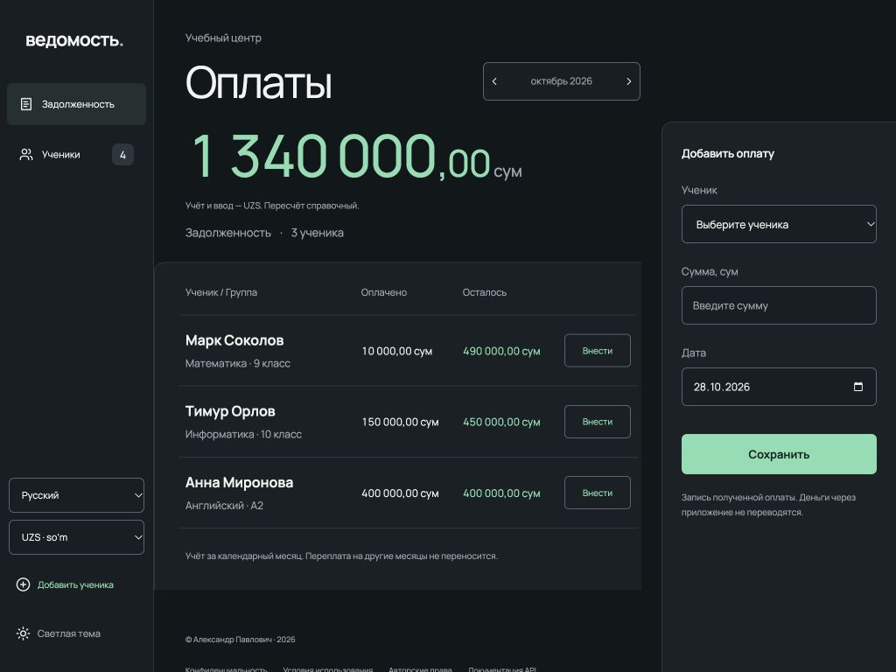

# Ведомость

Мини-учёт оплат учебного центра: ученики, платежи и задолженность за календарный месяц. Тестовый проект с адаптивным веб-интерфейсом, API на FastAPI и SQLite. Реальные платежи приложение не проводит.

[Открыть демо](https://dobropalm.tech/demos/vedomost/) · [Прямой адрес Cloudflare](https://vedomost-demo.dobropalm.workers.dev/demos/vedomost/)

В публичном демо каждый посетитель получает отдельный сеанс, который продлевается при каждом открытии демо; после 90 дней без посещений данные удаляются. Используйте только вымышленные данные. [Устройство и публикация демо](docs/cloud-deployment.md).



[Светлая тема](docs/desktop-light.png) · [Мобильная версия](docs/mobile.png)

Визуальная основа подготовлена с Higgsfield; текущий интерфейс использует светлую и тёмную темы, фиолетовый акцент и декоративную 3D-иллюстрацию. В боковой панели есть переключение тёмной и светлой тем; выбор сохраняется в этом браузере. Отдельный переключатель меняет справочную валюту отображения сумм. Тарифы и долг учитываются в UZS, а каждая оплата вводится в выбранной валюте UZS, RUB или USD и сохраняет исходную сумму вместе с зафиксированным эквивалентом в UZS. История показывает исходную сумму и валюту записи; эквивалент в UZS помечен отдельно. Источник, дата курса и состояние обновления видны рядом с долгом; для иностранной оплаты нужен свежий официальный курс. Интерфейс доступен на русском, узбекском (латиница) и английском; язык также сохраняется в браузере. Имена и группы из базы не переводятся.

## Запуск с нуля

Нужен Python 3.11+ (проверено на 3.13). Сборка фронтенда и Node.js не нужны. Для оплаты в RUB или USD нужен свежий официальный курс с сервера; оплату в UZS можно записать без интернета.

```bash
git clone https://github.com/kevinscott66/vedomost.git
cd vedomost
python3 -m venv .venv
source .venv/bin/activate
python -m pip install -r requirements.txt
python -m uvicorn app.main:app --host 127.0.0.1 --port 8773
```

Открыть <http://127.0.0.1:8773>. Для Windows активация окружения: `.venv\Scripts\activate`. При первом запуске база создаётся автоматически и остаётся пустой. Добавьте ученика кнопкой в интерфейсе. Данные сохраняются между перезапусками в `data/school.sqlite3`; каталог исключён из Git. Другой путь можно задать переменной `DATABASE_PATH`.

Необязательные **вымышленные** данные для просмотра (в другом терминале с активированным окружением):

```bash
python -m app.demo
```

Команда добавит четырёх учеников и три оплаты за текущий месяц только в пустую базу. Повторный запуск не создаёт дубликаты. Другую БД можно выбрать через `--database`.

## Что работает

- Создание, список, полное изменение и удаление учеников: имя, телефон, группа, месячный тариф.
- Добавление оплаты в UZS, RUB или USD с суммой и датой, просмотр истории конкретного ученика.
- Расшифровка долга: начисление, оплаты и остаток с сохранённым курсом каждой записи.
- Должники выбранного месяца: сумма внесённого, оставшийся долг, общий итог.
- Мобильный интерфейс, формы, состояния пустой базы, отсутствия долга и ошибок запросов.

Страница проекта: `/case`. Учебный сценарий `/try` показывает оплату и изменение курса на вымышленных данных; действия в нём не меняют базу.

Интерактивная документация: <http://127.0.0.1:8773/docs>. Она использует тот же дизайн, темы и языки; консоль отправляет запросы к локальному API. POST, PUT и DELETE меняют демонстрационную базу. Схема доступна по `/openapi.json`.

| Метод | URL | Назначение |
|---|---|---|
| POST / GET | `/students` | Создание / список учеников |
| GET / PUT / DELETE | `/students/{id}` | Просмотр / полная замена полей / удаление |
| POST | `/payments` | Добавление оплаты |
| POST | `/payments/{id}/void` | Отмена с телом `{"reason":"ошибка валюты"}`; повтор с той же причиной безопасен |
| GET | `/activity?before=51` | Журнал по 50 событий, `next_before` для следующей страницы |
| GET | `/students/{id}/payments` | Оплаты ученика, новые даты первыми |
| GET | `/students/{id}/statement?month=2026-10` | Начисление, оплаты и остаток за месяц |
| GET | `/debtors?month=2026-10` | Должники месяца |
| GET | `/exchange-rates` | Курсы UZS/RUB/USD, источник, даты и состояние обновления |

Пример тела ученика:

```json
{"name":"Анна","phone":"+7 000 000-00-00","group":"А2","monthly_fee":"800000.00","start_month":"2026-10"}
```

Пример оплаты в исходной валюте:

```json
{"student_id":1,"amount":"200.00","currency":"RUB","date":"2026-10-28"}
```

Ответ содержит исходные `amount` и `currency`, а также `base_amount` (эквивалент в UZS), `exchange_rate` (десятичная строка), `rate_date` и `rate_source`. Для UZS курс равен 1.00. Максимальная исходная сумма — 9 999 999 999,99; эквивалент и общая сумма оплат ученика за месяц должны помещаться в знаковое 64-битное целое в сотых UZS.

Ошибки: `422` — неверные поля/дата/месяц; `404` — неизвестный ученик; `409` — попытка удалить ученика с оплатами. Удаление ученика без оплат возвращает `204`. Денежные поля в ответах — строки с двумя знаками после запятой.

## Правила расчёта

Долг = текущий месячный тариф − сумма неотменённых платежей ученика в выбранном календарном месяце. В список включены только положительные долги. Частичные платежи складываются, переплата не переносится на другой месяц. Изменение текущего тарифа влияет и на расчёт прошлых месяцев. Начисления начинаются с `start_month` (месяц начала обучения), более ранние месяцы не создают долг. Поле добавлено по уточнению пользователя; при создании без него используется текущий месяц сервера, при изменении без него сохраняется прежнее значение. Истории тарифов и пропорционального начисления пока нет.

Суммы обрабатываются через `Decimal` и округляются до сотых по правилу half up. Тариф и долг рассчитываются в UZS; тариф может быть нулевым, платёж — только положительным. Оплата принимается в UZS, RUB или USD. При записи сохраняются исходные сумма и валюта, а также неизменяемый эквивалент в UZS и данные применённого курса. Иностранная сумма пересчитывается по свежему официальному курсу, доступному серверу в момент записи. Для оплаты с прошлой датой применяется курс на момент записи, а не исторический курс даты оплаты. Если свежего официального курса нет, запись оплаты в RUB или USD отклоняется; UZS работает офлайн. Существующие платежи при миграции считаются оплатами в UZS.

Отдельный переключатель отображения пересчитывает суммы справочно по текущему курсу и не меняет записанные оплаты. Валюта отображения и язык независимы. Дата оплаты — календарная дата без часового пояса; разрешены прошлые даты, начиная с месяца начала обучения, и корректные будущие даты. Изменить начало обучения на месяц позже уже записанных оплат нельзя. Месяц — `YYYY-MM`, от `0001-01` до `9999-12`.

Ученика с платежами удалить нельзя, даже если взносы отменены: история сохраняется. В истории оплат есть «Отменить взнос» и «Исправить»: отмена требует причину, сохраняет исходную сумму, курс и дату и исключает запись из расчёта долга. Исправление сначала отменяет старый взнос и только заполняет форму нового; новую оплату нужно проверить и сохранить отдельно. Для неё используется текущий курс записи, старый курс не переписывается. Вкладка «Журнал» показывает создание, изменения и удаление учеников, добавление и отмену взносов; старые действия до включения журнала не восстанавливаются. Телефоны не уникальны: родительский номер может быть общим у нескольких учеников.

## Автоматическое обновление курса

Сервер запрашивает [ЦБ Узбекистана](https://cbu.uz/ru/arkhiv-kursov-valyut/veb-masteram/) на текущую дату. Если этот источник недоступен, кросс-курс рассчитывается из дневных курсов USD и UZS [Банка России](https://www.cbr.ru/development/SXML/); источник указан в интерфейсе. Это официальные дневные курсы, а не рыночные котировки в реальном времени. В выходные и праздники дата действующего курса может быть раньше текущей.

Браузер получает данные при открытии страницы, раз в 15 минут на активной вкладке, при возвращении к ней и восстановлении сети. Сервер хранит курс час; после ошибки повторяет внешний запрос не чаще раза в пять минут. Последний полученный курс сохраняется в `<имя-файла-БД>.exchange-rates.json` рядом с БД и используется при сбое с отметкой «устарел». До первой успешной загрузки есть явно обозначенный резервный курс от 28.10.2026. Отсутствие сети не выдаётся за актуальный курс.

Внешним поставщикам отправляется только запрос курса; записи учеников и оплат остаются локально. Для добавления иностранной оплаты сервер должен получить свежую официальную котировку; отображение RUB/USD остаётся справочным и может использовать сохранённые данные при сбое.

## Проверки

```bash
python -m pip install -r requirements-dev.txt
python -m pytest -q
python -m ruff check app tests
python -m ruff format --check app tests
# Дополнительные проверки локализации (нужен Node.js 20+):
node --test tests/*.test.cjs
```

Проверяются CRUD и защита истории, частичная/полная оплата и переплата, несколько платежей, нулевой тариф, точность сотых, границы месяцев/года, неверные суммы и даты, пересчёт тарифа, сохранность после перезапуска, доступность страницы и API. Фактические результаты и ручные сценарии: [docs/verification.md](docs/verification.md).

## Если бы была ещё неделя

1. Авторизация и роли: администратор, кассир, просмотр.
2. История тарифов и начисления по периодам вместо пересчёта прошлого по текущему тарифу.
3. Связанные корректировки одной транзакцией и фильтры журнала по ученику и типу операции.
4. Постраничные списки, фильтры и поиск для больших ведомостей.
5. Резервное копирование и экспорт сверки за месяц.

## Ограничения и права

Локальный демонстрационный проект, без авторизации и платёжных интеграций. Не публикуйте сервер в интернет и не вводите реальные персональные данные. Повтор оплаты с тем же `Idempotency-Key` и телом возвращает исходную запись; другое тело с тем же ключом даёт 409. Форма повторно использует ключ после сетевой ошибки. Для клиентов без заголовка каждый POST по-прежнему означает новую оплату. Локальный API допускает только Host localhost/127.0.0.1/[::1], отклоняет чужой Origin при записи и требует application/json. Эти меры не заменяют авторизацию для публичного сервиса.

В подвале есть `/privacy`, `/terms` и `/rights` в общем стиле приложения. Русская редакция описывает контекст России, узбекская — Узбекистана, английская содержит отдельные пояснения для EU/EEA и США. Это уведомления локального демо, а не готовая политика реального учебного центра: перед обработкой настоящих данных нужны сведения об операторе, правовых основаниях, сроках хранения и работающие процессы реализации прав. Выбор языка не определяет применимое право.

Публичный репозиторий доступен для ознакомления и оценки. Коммерческое использование и распространение требуют письменного разрешения: [LICENSE.txt](LICENSE.txt). Это source-available проект, а не свободная open-source лицензия. Публичность исходников технически не предотвращает копирование.

[Архитектура и дизайн](docs/architecture.md) · [План реализации](docs/implementation-plan.md) · [Использование AI](docs/ai-worklog.md)

[Проверка по ТЗ и границы правовых уведомлений](docs/readiness.md)
